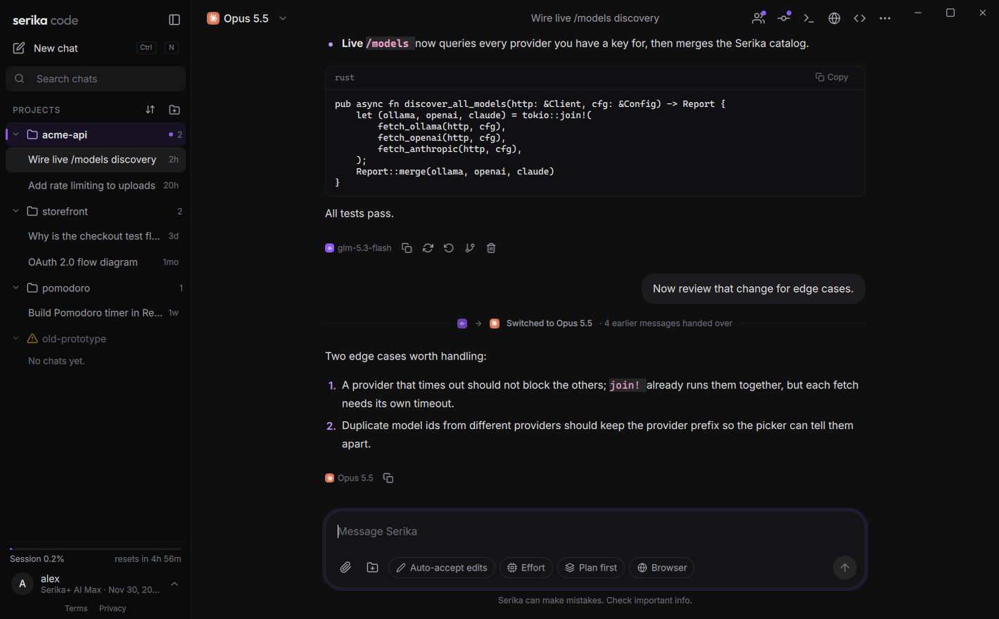
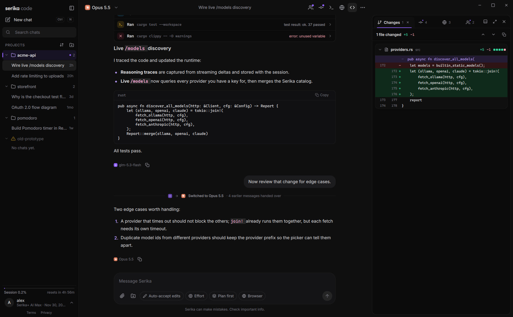
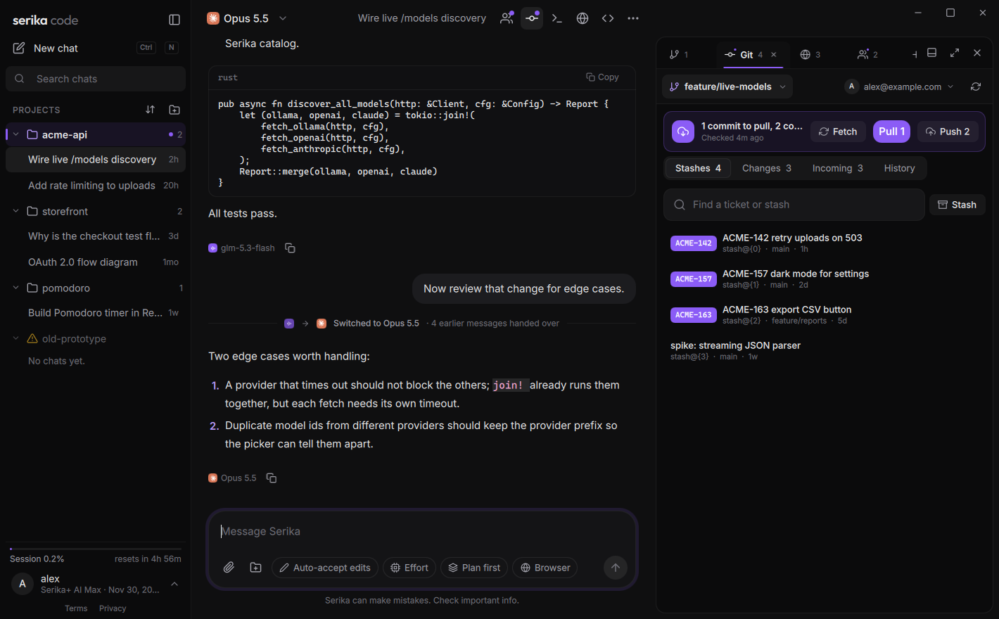
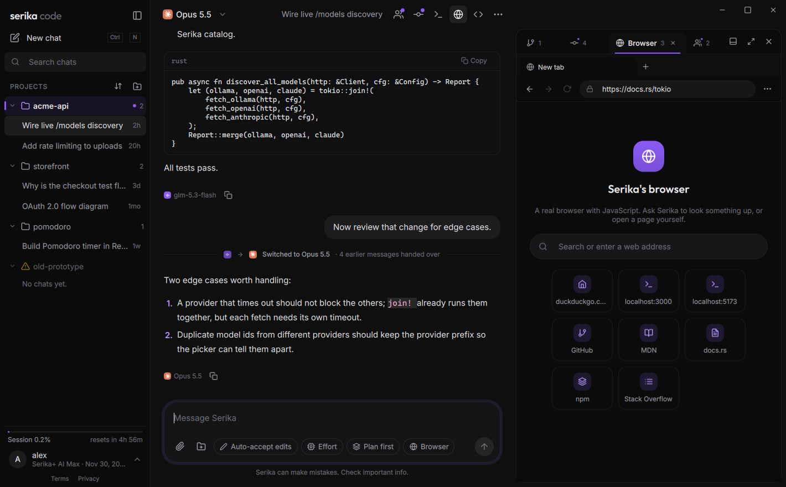
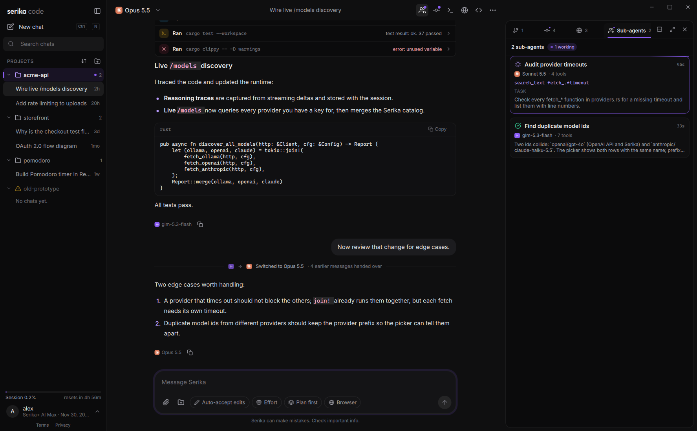
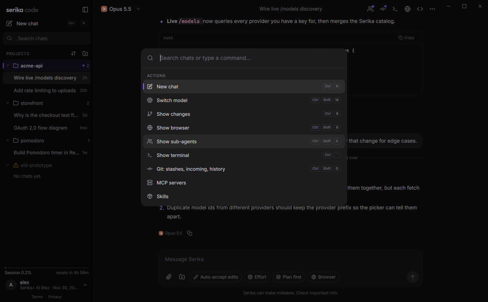

<div align="center">


# Serika Code

**A fast, native coding agent for your desktop and terminal.**

Chat with any model, let it read and edit your project, run commands, browse the web, and
review every change, in one app that feels as quick as your editor.

[Download](https://github.com/serika-dev/serika-code/releases/latest) ·
[Install](#install) ·
[Features](#features) ·
[Docs](#docs)



</div>

## Why Serika Code

- **Native and quick.** A Qt 6 desktop app and a Rust runtime. No browser in a window, no
  Electron. Lists, panels and dialogs open at once and move with smooth, springy animations.
- **Every model in one place.** SerikaAI models, plus Claude Code and Codex on your own
  subscriptions. Switch models in the middle of a chat and the new one gets the context.
- **Built for real projects.** Edits across files, a terminal, a real browser, a Git panel,
  sub-agents, MCP servers and skills, all in the same window.

## Features

### Chats that keep going

Start a chat, open another one, switch project: the first one keeps working in the
background. The sidebar shows which chats are running, which wait for your approval, and
which finished while you were away. A new chat shows up in the sidebar as a draft right away,
and anything you typed but did not send is kept for later.

### Every change, reviewed



Each edit the agent makes appears in the Changes panel as a line-numbered diff, linked from
the tool call that made it. Rewind a chat to undo its file changes, or fork it to try another
direction.

### Git, the way you work



- **Stashes by ticket.** Keep one stash per ticket, find it by number, see its files and
  diffs, then apply, pop or drop it.
- **Sync at a glance.** What is waiting to pull, what is not pushed yet, and one click for
  each, with progress you can see. Nothing runs twice if you click twice.
- **Branches.** Search, switch (remote branches get a local copy that tracks them) or create.
- **Accounts per project.** Commit as your work or personal identity per project. GitHub
  logins from the GitHub CLI are picked up on their own, and fetch, pull and push sign in with
  the right one.

### A browser the agent can use



A real Chromium-based browser, streamed live into the app. The agent opens pages, reads them,
clicks and types; you can watch, scroll and take over. Claude Code and Codex chats get the
same browser through MCP.

### Sub-agents



Let a chat hand side tasks to sub-agents that run in parallel, each on the model you pick,
and follow them in their own panel.

### Make it yours

- **Docks like VS Code.** Changes, Git, Browser, Sub-agents and Terminal are tabs you can drag
  between a right and a bottom dock, resize, and maximize.
- **Command palette** (`Ctrl+K`) and keyboard shortcuts for everything; `Ctrl+1…9` and
  `Ctrl+Tab` move between chats.
- **Group the sidebar** by project, by date or as one list, and sort it your way.
- **Project settings** for each folder: who it commits as, which login it uses, its
  instruction files, skills and MCP servers.
- **Themes, accent colors and text sizes.**



### Works with what you already use

- **MCP**: the current spec (2026-07-28) and every earlier revision, over stdio,
  Streamable HTTP and HTTP+SSE. Servers you set up in Claude Code, Claude Desktop, Codex or a
  project's `.mcp.json` appear on their own.
- **Skills**: `SKILL.md` folders from your project, Claude Code (and its plugins) and Codex.
- **Project instructions**: `AGENTS.md`, `CLAUDE.md` or `.serika/instructions.md`, the same
  files other coding agents read.

## Install

Get the desktop app from [Releases](https://github.com/serika-dev/serika-code/releases/latest):

| Platform | Download |
| --- | --- |
| Windows 10/11 | `serika-code-<version>-windows-x64-setup.exe`: installs for you alone (no admin), adds a Start menu entry and the `serika` command. A portable `.zip` is there too. |
| Linux, any distribution | `serika-code-<version>-x86_64.AppImage`: make it executable and run it. |
| Debian, Ubuntu | `serika-code_<version>_amd64.deb`: `sudo apt install ./serika-code_*_amd64.deb` |

Both desktop packages include the `serika` command line. To install only the CLI:

```bash
# Linux and macOS
curl -fsSL https://raw.githubusercontent.com/serika-dev/serika-code/main/install.sh | bash
```

```powershell
# Windows
irm https://raw.githubusercontent.com/serika-dev/serika-code/main/install.ps1 | iex
```

To build it yourself, see [docs/BUILDING.md](docs/BUILDING.md).

## Use

```bash
serika auth login          # sign in with your Serika account
serika                     # chat in the terminal
serika "Explain how this project is built"
serika desktop             # open the desktop app
serika doctor              # check your setup
```

More in [docs/CLI.md](docs/CLI.md) and [docs/DESKTOP.md](docs/DESKTOP.md).

## Good to know

- Permission modes decide what the agent may do without asking; they are not a sandbox. See
  [docs/SECURITY.md](docs/SECURITY.md).
- Claude Code and Codex run on your own logins. Serika Code does not resell either.
- Sessions are stored locally in SQLite; credentials go to your operating system's
  credential store.

## Docs

[Architecture](docs/ARCHITECTURE.md) ·
[Building](docs/BUILDING.md) ·
[Configuration](docs/CONFIGURATION.md) ·
[Authentication](docs/AUTHENTICATION.md) ·
[Serika API](docs/SERIKA_API.md) ·
[Security](docs/SECURITY.md) ·
[CLI](docs/CLI.md) ·
[Desktop](docs/DESKTOP.md) ·
[Development](docs/DEVELOPMENT.md) ·
[Changelog](CHANGELOG.md)

## License

Apache-2.0. See [LICENSE](LICENSE).
